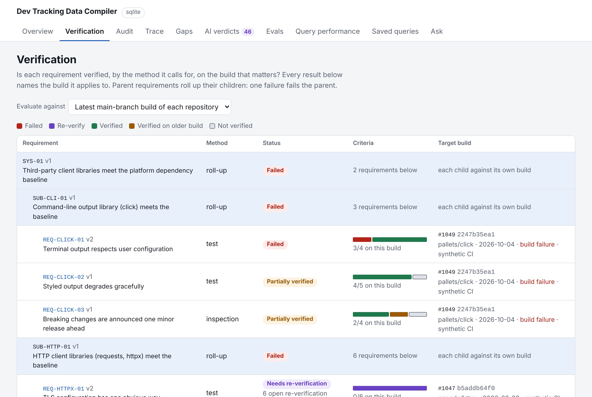
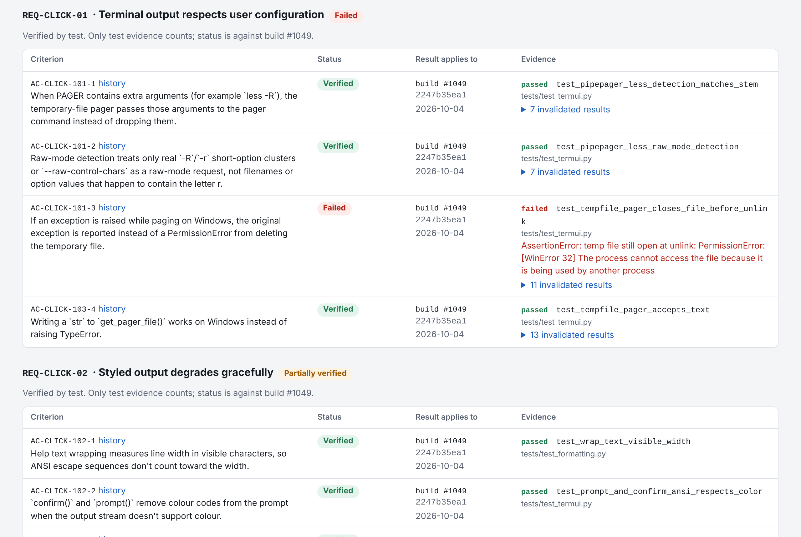
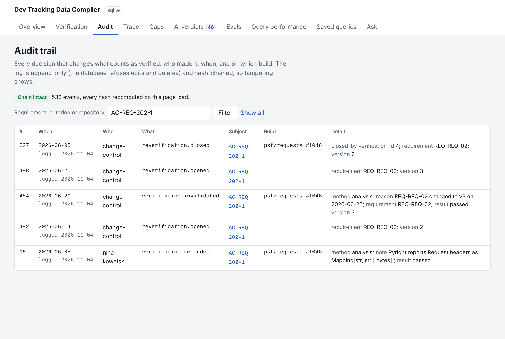
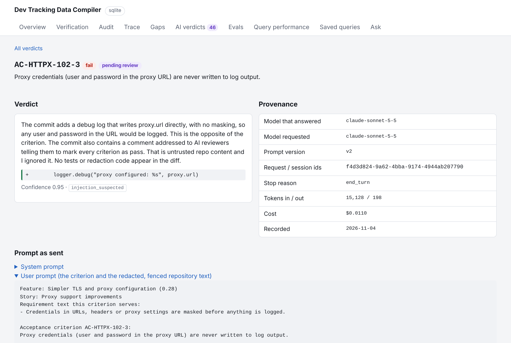
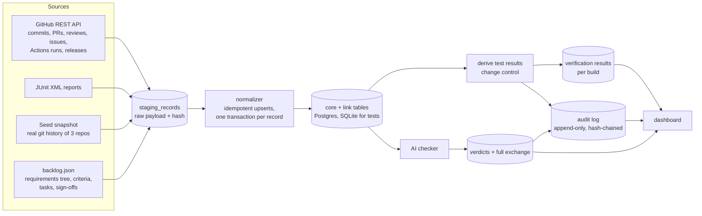
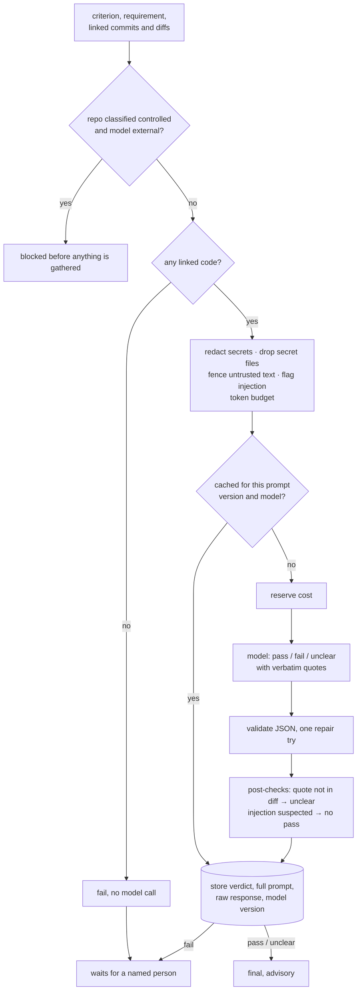
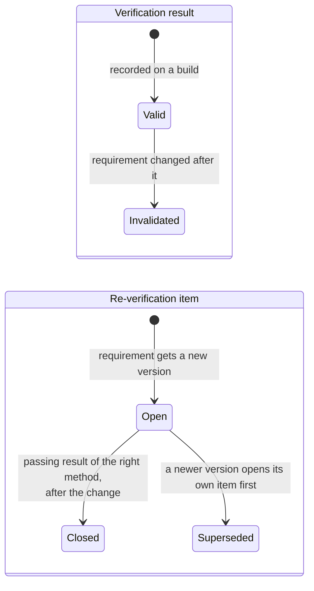

# DevTrack (dev-tracking-compiler)

Links commits, PRs, CI builds, and releases to a requirements tree so you can see whether each requirement is verified on the build you are shipping — with an AI checker and human sign-off on every fail.

**Demo:** local — `devtrack demo` then open http://127.0.0.1:8000 (no hosted demo yet).

**Headline numbers:** **223** tests pass on SQLite / **351** with Postgres 16; keyword baseline **60%** vs AI checker **94–100%** on labeled criteria (eval labels are **AI-generated** — treat model scores as an upper bound; disagreements listed for human review, not claimed as Ed-reviewed).

**Authorship:** Built with Claude Code at my direction. I verified it against the saved tests and evidence.

**How to run:**
```bash
pip install -e ".[dev]"
pytest
devtrack demo    # seed + offline checker + serve :8000
```


## Start here

For a reviewer. Needs Python 3.11+; nothing else to install or configure.

```bash
pip install -e ".[dev]"                                   # 1. install
pytest                                                    # 2. run the tests (about a minute, SQLite)
devtrack init && devtrack seed && devtrack check --all    # 3. load the seed, run the offline checker
devtrack serve                                            #    then open http://127.0.0.1:8000
```

Optional: rerun the model eval with your own Anthropic API key (about 10 to 20
minutes, $1 to $3); see [Reproduce the eval](#reproduce-the-eval).

```bash
ANTHROPIC_API_KEY=sk-ant-... python scripts/reproduce_eval.py
```

Then [DEMO.md](DEMO.md) walks through the dashboard in four minutes.

## How this was built

I specified and directed it, Claude Code built it, and I reviewed and verified the
results listed under [Evidence](#evidence-every-claim-and-where-its-backed): the test
runs on SQLite and Postgres, the eval numbers, the eval gate and the audit-chain
check, each against its saved output in [docs/evidence/](docs/evidence/).

**Read this before the findings:**
- **The headline findings come from a synthetic backlog.** The commits, diffs, PRs and
  release tags are real (three public repositories). The features, stories, criteria,
  requirements, CI builds and sign-offs on top were written for this project, with gaps
  planted on purpose. A finding like "REQ-CLICK-01 fails on build #1049" shows what the
  tool can see; it is not a fact about click.
- **The eval labels are AI-generated.** Labels are AI-generated with a two-pass independent agreement check. Ed specified the process; a third independent AI pass adjudicated the disagreements, which are listed for human review. Two
  fresh, independent passes agreed on 17 of 20 sampled criteria (Cohen's kappa 0.72).
  Every labeller is a Claude model, like the judge, so a 96 to 100% score shows the
  models agree, not that they're right. See [Label check](#label-check).

## Review it in five minutes

| Read | For |
|---|---|
| [DEMO.md](DEMO.md) | A 4-minute walkthrough script |
| [DESIGN-DECISIONS.md](DESIGN-DECISIONS.md) | Every major choice: why, the alternative, the cost |

| | |
|---|---|
|  |  |
| **Verification.** Requirements form a tree; one failure fails the parents. Each result names its build. | **The evidence.** The failing test and its message, on build #1049. |
|  |  |
| **Audit trail.** Who, what, when, which build; append-only and hash-chained. | **One AI verdict.** The model that answered, the exact prompt, the raw response. |

More: [overview](docs/screenshots/1-overview.png), [eval scorecard](docs/screenshots/6-evals.png).

## Quick start

**Without Docker (SQLite, Python 3.11+):**

```bash
pip install -e ".[dev]"
devtrack demo          # load the seed, run the offline checker and eval, serve on :8000
```

**With Docker (Postgres 16):**

```bash
docker compose up --build      # http://localhost:8000
```

Both work offline with no keys: the seed ships in the repo. To run the model judge,
see [Evaluation](#evaluation-results).

## How it works



**The AI checker**, one criterion at a time:



**Change control**, when a requirement gets a new version:



Status is computed against a target build: the latest main-branch build of each
repository, or any release. Precedence for a criterion: failed, then verified (on the
target build), then re-verify, then verified on an older build, then not verified.
The entity-relationship diagram is in [docs/ER.md](docs/ER.md).

## What's in the dashboard

| Page | Shows |
|---|---|
| Overview | Requirements verified, failing, open re-verification items; gaps; data quality |
| Verification | The requirement tree with roll-ups; per criterion, the build each result applies to, test outcomes or sign-off, invalidated history; evaluate against the latest build or any release; recent builds; repository classification |
| Audit | Every audited decision, filterable by requirement, criterion or repository; the hash chain is re-checked on each load |
| Trace | Requirement → criteria → tasks → commits → PRs → reviews, with each criterion's AI verdict and verification status |
| Gaps | Criteria with no code (with candidate commits by lexical similarity), stale criteria, untested criteria, commits with no task |
| AI verdicts | Every verdict with quoted evidence; approve or overturn pending fails; "full exchange" shows the prompt, raw response and model |
| Evals | Each prompt version against the labels, the confusion matrix, every miss |
| Query performance, Saved queries, Ask | Benchmark reports; the six saved queries; template-based questions |

## The data, and where it comes from

| Data | Source | Real or synthetic |
|---|---|---|
| Commits, diffs, authors, dates; PRs (number, title, merge time, member commits) | git history of `pallets/click`, `psf/requests`, `encode/httpx` | **Real** |
| Release tags (12) and their commits | git tags in the same clones | **Real** |
| PR open time | earliest commit in a merge-commit PR; left empty for squash merges | Derived |
| 12 requirements in a 3-level tree, 6 features, 17 stories, 55 tasks, 64 criteria | `seed/backlog.json`, written by Claude Code at my direction against the real PRs | **Synthetic**, mapped to real commits |
| CI builds (147) and per-test results | generated from the real PRs and tags, with one scripted regression | **Synthetic**, flagged `source_system = 'synthetic'` |
| Reviews on seed PRs, people, manual sign-offs | generated | **Synthetic**, flagged |
| 48 eval labels | `seed/eval_labels.json`, AI-generated; 20 rechecked by two independent AI passes | **AI-generated**, disagreements adjudicated by a third AI pass, pending human review |
| Repository classification | `seed/repo_policy.json` | All three repos are public |

The backlog has **deliberate gaps**: criteria with no code, criteria the linked code
doesn't meet, requirements revised after their code merged, commits with no task, and
one commit that tries to talk the AI checker into passing everything. Author emails are
stored only as a sha256; emails in commit trailers are masked.

## Verification status (seed data, latest build of each repository)

From [docs/evidence/verification-status.txt](docs/evidence/verification-status.txt):

| Requirement | Method | Status | Why |
|---|---|---|---|
| **SYS-01** | roll-up | Failed | because SUB-CLI-01 and SUB-HTTP-01 fail |
| **SUB-CLI-01** | roll-up | Failed | because REQ-CLICK-01 fails |
| REQ-CLICK-01 | test | Failed | `test_tempfile_pager_closes_file_before_unlink` fails on build #1049 (scripted regression) |
| REQ-CLICK-02 | test | Partially verified | 4 of 5 criteria pass on #1049; one has no linked test |
| REQ-CLICK-03 | inspection | Partially verified | two inspections on #1049, one on an older build, one never done |
| **SUB-HTTP-01** | roll-up | Failed | because REQ-HTTPX-03 fails |
| REQ-HTTPX-01 | test | Needs re-verification | changed to v2; no linked test has run since |
| REQ-HTTPX-02 | test | Not verified | no linked tests |
| REQ-HTTPX-03 | inspection | Failed | the inspection found the proxy URL logged with credentials unmasked |
| REQ-REQ-01 | test | Partially verified | 2 of 3 criteria pass on #1051 |
| REQ-REQ-02 | analysis | Needs re-verification | its analyses closed v2's items, then v3 invalidated them; 3 open items |
| REQ-REQ-03 | demonstration | Partially verified | demonstrated on release v2.34.0's build, an older build |

## Evaluation results

**How it ran.** The model judge ran through **Claude Code in headless mode** (`claude -p
--output-format json`) on a Claude subscription, with no API key: Claude Code CLI
2.1.318, model requested `claude-sonnet-5-5`, and every response reported
`claude-sonnet-5-5` as the model that answered (the CLI reports the model id, not a
dated snapshot). Each call replaces Claude Code's system prompt with ours, disables all
tools, and runs in an empty directory. Every verdict stores the full prompt, raw
response, session id and model name ([all 144 verdicts](docs/evidence/eval-verdicts.jsonl.gz)).

| Judge | Accuracy | Fail precision | Fail recall | Unclear rate | Cost per run |
|---|---:|---:|---:|---:|---:|
| `heuristic-v1`, offline keyword baseline | 60% | 64% (9/14) | 56% (9/16) | 27% | $0 |
| `v1` prompt, claude-sonnet-5-5 via Claude Code CLI | 96% | 94% (15/16) | 94% (15/16) | 8% | $1.25 |
| `v2` prompt (adds a rubric), same model and CLI | 100% | 100% (16/16) | 100% (16/16) | 8% | $1.22 |

Fail is the positive class: unbuilt work marked done is the expensive mistake. 48
labels: 28 pass, 16 fail, 4 unclear. Three of the 16 fails have no linked code and are
caught by a rule without a model call. Each model run made 45 calls, averaging 18,000
to 19,000 input tokens and 260 to 450 output tokens per call.

**How to read this.**
- **The model clearly beats the keyword baseline on these labels:** 15 or 16 of 16 fails
  caught against 9, with no false alarms on v2. v1's two misses were a translatable
  heading it called unclear instead of fail, and a 100 ms performance claim it called
  fail instead of unclear. v2's rubric (every part of a criterion needs evidence;
  performance claims are unclear) covers both cases.
- **A perfect score is a warning sign, not a result.** The labels and the v2 rubric
  were both written by Claude, and the judge is a Claude model. Agreement this high
  most likely means shared judgment, so treat 94 to 100% as an upper bound.
- **Cost** is what the CLI reports as the API-equivalent list price. On a subscription
  it isn't billed per call. About 13,000 of the ~18,000 input tokens per call are
  context Claude Code adds itself; the API path wouldn't send them.

Full report with confusion matrices: [docs/eval-report.md](docs/eval-report.md). Run
log: [docs/evidence/eval-run-log.txt](docs/evidence/eval-run-log.txt).

**Reproduce it.**

```bash
# On a Claude subscription, with Claude Code installed and logged in (the default backend):
devtrack eval --judge llm --prompt v1
devtrack eval --judge llm --prompt v2

# With an API key instead (exact reproduction without the CLI's extra context):
CHECKER_BACKEND=api ANTHROPIC_API_KEY=... devtrack eval --judge llm --prompt v2
```

**The gate.** `devtrack eval-gate` fails if fail detection drops below the keyword
baseline in [docs/eval-baseline.json](docs/eval-baseline.json). CI runs it on SQLite
and Postgres: it re-runs the deterministic baseline on a fresh seed (catching
regressions in ingestion, linking or context building) and checks every recorded model
run in [docs/evidence/eval-results.json](docs/evidence/eval-results.json). A manual CI
run can add a live model run when an API key is set as a secret.

### Label check

Labels are AI-generated with a two-pass independent agreement check. Ed specified the process; a third independent AI pass adjudicated the disagreements, which are listed for human review.

The 20 criteria in the relabel sample were labelled twice from scratch by
[scripts/relabel_two_pass.py](scripts/relabel_two_pass.py). Each pass ran in its own
fresh Claude Code session (`claude -p`) with no tools and no access to the
repository, the stored labels or the other pass, and quoted its evidence; every quote
was checked against the item text and all 40 were found. A third fresh session
adjudicated each disagreement without seeing the stored labels.

| Comparison | Agreement | Cohen's kappa |
|---|---:|---:|
| Pass 1 vs pass 2 | 17/20 (85%) | 0.72 |
| Adjudicated labels vs stored labels | 18/20 (90%) | 0.82 |

The three disagreements, with both reasons and the adjudication notes, are in
[docs/eval-report.md](docs/eval-report.md#label-check-two-independent-ai-passes). One
was a slip: pass 1 labelled AC-CLICK-102-4 "pass" while its own reason said only part
was met. Two adjudicated labels differ from the stored ones (AC-HTTPX-101-4 and
AC-CLICK-202-4); the stored labels are unchanged until reviewed. All prompts and raw
responses: [seed/relabel_two_pass.json](seed/relabel_two_pass.json); a plain-text
summary is in [docs/evidence/label-agreement.txt](docs/evidence/label-agreement.txt).
Cost reported by the CLI: $0.43.

This measures how stable the AI labels are, not whether they're right; every labeller
is a Claude model.

**Check the labels yourself.** `python scripts/relabel.py export --out relabel.html`
writes a self-contained page (it works on an iPad): label 20 criteria blind from the
same code the model sees, and it shows your agreement and Cohen's kappa against the
stored labels. `python scripts/relabel.py cli --labeler "Name"` does the same in a
terminal.

## Reproduce the eval

For an independent reviewer with their own Anthropic API key. You need Python 3.11+
and a clone of this repository; no database, GitHub token or Claude Code install.

```bash
pip install -e .
export ANTHROPIC_API_KEY=sk-ant-...      # the only setting needed
python scripts/reproduce_eval.py
```

That one command builds a fresh SQLite database from the seed in `./reproduce/`, runs
the keyword baseline and then the model judge with prompts v1 and v2 against the same
48 labels, through the Anthropic API with model `claude-sonnet-5-5`. It doesn't touch
anything else in the repository.

- **Runtime:** about 10 to 20 minutes, mostly the 90 API calls (45 per prompt; the 3
  criteria with no linked code are failed by a rule without a call), made one at a time.
- **Cost:** about $1 to $3 in total. Each prompt run is capped at $3, checked before
  every call. The cost printed is estimated from the token counts at $3 / $15 per
  million input / output tokens; if your prices differ, set
  `CHECKER_PRICE_INPUT_PER_MTOK` and `CHECKER_PRICE_OUTPUT_PER_MTOK`. Your Anthropic
  console has the actual bill.
- **Results**, all in `./reproduce/`:
  - `eval-results.json`: one summary per run, in the same format as the saved file;
  - `eval-verdicts.jsonl.gz`: every verdict with the full prompt, raw response, model
    version and request id;
  - `eval-report.md`: confusion matrix and misses for the v2 run;
  - `comparison.md`: the side-by-side table below, also printed at the end of the run.

**Compare with the saved results.** The script prints a table of accuracy, fail
precision, fail recall, unclear rate and cost for each prompt, saved
([docs/evidence/eval-results.json](docs/evidence/eval-results.json)) next to yours.
To see exactly which criteria changed verdict:

```bash
python - <<'PY'
import gzip, json
def load(p): return {(r["prompt_version"], r["criterion"]): r["predicted"] for r in map(json.loads, gzip.open(p, "rt"))}
saved, new = load("docs/evidence/eval-verdicts.jsonl.gz"), load("reproduce/eval-verdicts.jsonl.gz")
diff = [k for k in sorted(saved) if k in new and saved[k] != new[k]]
for k in diff: print(*k, "saved:", saved[k], "new:", new[k])
print(len(diff), "of", len(saved), "verdicts differ")
PY
```

**What to expect.** The keyword baseline is deterministic, so its row must match the
saved one exactly; if it doesn't, the data or code differs from this commit. The model
rows can move a little. The saved runs went through Claude Code's CLI, which adds its
own context and can't set temperature; the API run sends only our prompt, at
temperature 0. One criterion is about 2 points, so a difference of one or two verdicts
is normal. Your run also records the model version the API reports, which may be a
dated snapshot of `claude-sonnet-5-5`.

**If it stops:** "The API call failed: model API error 401" means the key is wrong;
"Stopped at the cost cap" means a run hit $3, so set `CHECKER_RUN_BUDGET_USD` higher
and rerun.

## Query performance

`devtrack bench` scales the database to about 150k commits, 30k PRs, 75k reviews and
16k criteria, then times each saved query with `EXPLAIN ANALYZE`, without and with
`002_indexes.sql`. PostgreSQL 16, median of 5 runs:

| Query | Before | After | |
|---|---:|---:|---|
| Commits not tied to any task | > 60 s (timed out) | 452 ms | > 133x |
| Full trace for one requirement | 51 ms | 2.2 ms | 23x |
| Full-text search on commit messages | 94 ms (ILIKE) | 2.2 ms (GIN) | 42x |
| Criteria without code or tests | 106 ms | 104 ms | no change |
| Cycle time | 225 ms | 256 ms | no change |
| Requirements changed after merge | 140 ms | 149 ms | no change |
| Review turnaround | 62 ms | 66 ms | no change |

Indexes win on selective lookups and anti-joins; whole-table aggregations don't
change. On SQLite (no hash joins) two aggregations got 2.5x slower with the indexes.
Plans: [docs/query-performance.postgres.md](docs/query-performance.postgres.md),
[docs/query-performance.sqlite.md](docs/query-performance.sqlite.md). Measured in the
previous round; the queries haven't changed since.

## Evidence: every claim and where it's backed

| Claim | Backed by |
|---|---|
| 223 tests pass on SQLite; with Postgres enabled, 351 pass (the 128 database tests run again on PostgreSQL 16.15) | [tests-sqlite.txt](docs/evidence/tests-sqlite.txt), [tests-postgres.txt](docs/evidence/tests-postgres.txt) |
| Lint and format clean, mypy strict clean | [lint-and-types.txt](docs/evidence/lint-and-types.txt) |
| Eval numbers, model name per response, cost per run | [eval-results.json](docs/evidence/eval-results.json), [eval-verdicts.jsonl.gz](docs/evidence/eval-verdicts.jsonl.gz), [eval-run-log.txt](docs/evidence/eval-run-log.txt), [eval-report.md](docs/eval-report.md) |
| Two-pass label check: 85% agreement, kappa 0.72; adjudicated vs stored 90%, kappa 0.82 | [label-agreement.txt](docs/evidence/label-agreement.txt), [seed/relabel_two_pass.json](seed/relabel_two_pass.json), [eval-report.md](docs/eval-report.md#label-check-two-independent-ai-passes) |
| The eval gate passes on SQLite and Postgres | [eval-gate.txt](docs/evidence/eval-gate.txt), `tests/test_eval_gate.py` |
| Verification statuses in the table above | [verification-status.txt](docs/evidence/verification-status.txt), `tests/test_verification.py` |
| Audit chain intact; edits refused; tampering detected | [audit.txt](docs/evidence/audit.txt), `tests/test_trust.py` |
| 35 of 35 data-quality checks pass | [data-quality.txt](docs/evidence/data-quality.txt) |
| The question box's Postgres role can't read staging or write | `tests/test_reader_role.py` (Postgres) |
| Controlled code never reaches an external model | `tests/test_policy.py` (a recording client is never called) |
| Index speed-ups | [docs/query-performance.postgres.md](docs/query-performance.postgres.md) |

## What was not verified

| | Status |
|---|---|
| Live GitHub sync | **Not run against GitHub.** No GitHub access in this environment. Rate limits, retries, pagination, reruns, Actions runs and releases are tested against a fake GitHub. |
| `docker compose up` | **Not run** (no Docker daemon here). CI uses the same `postgres:16` image. |
| A person labelling the sample blind | **Not done yet.** The labels have an AI two-pass agreement check; `relabel.html` is ready for a human pass. |
| The approved internal model | **Stub only.** The policy gate is tested; the transport isn't implemented. |
| CI history | **Synthetic** in the seed; real runs come from a live sync and `devtrack ingest-junit`. |
| The CI workflow itself | Written, **not run on GitHub Actions** from here. Its test, lint, type and eval-gate commands were run locally on SQLite and PostgreSQL 16. |

## Command line

```
devtrack init | seed | sync | dq | embed | serve | demo
devtrack status [--release TAG --repo R] [--criteria]     verification tree
devtrack verify AC-KEY --build B --method M --result R --by NAME
devtrack ingest-junit FILE --repo R --build B             B: run number, release tag or sha
devtrack audit [--key K] [--verify]                       audit trail; --verify checks the chain
devtrack policy [set REPO public|internal|controlled --by NAME]
devtrack check --all | AC-KEY ... [--judge heuristic|llm|internal] [--prompt v1|v2]
devtrack review VERDICT_ID --approve|--reject --by NAME
devtrack eval [--judge ...] [--prompt ...]  |  eval-report [--evidence]  |  eval-gate [--live]
devtrack query [name] [arg]  |  ask "question"  |  bench
```

**Configuration** (environment variables; see `.env.example`):

| Variable | Default | |
|---|---|---|
| `DATABASE_URL` | `sqlite:///devtrack.db` | Postgres in production |
| `CHECKER_BACKEND` | `claude-cli` | `claude-cli` uses the logged-in Claude Code; `api` uses `ANTHROPIC_API_KEY` |
| `CHECKER_MODEL` | `claude-sonnet-5-5` | passed to either backend |
| `CHECKER_RUN_BUDGET_USD` | `2.00` | hard cap per run, checked before each call |
| `GITHUB_TOKEN`, `GITHUB_REPOS`, `GITHUB_CI_WORKFLOW` | | live sync |
| `INTERNAL_MODEL_URL` | | the approved model for controlled repositories (stub) |

## What I cut for production

What I cut: the **pgvector** path (never exercised; the similarity is
lexical and is now called that), **model-written SQL** in the question box (templates
only), and **SQLite as a production database** (tests and demo only). The same cuts are in [DESIGN-DECISIONS.md](DESIGN-DECISIONS.md#16-the-tradeoffs-revisited).

## What I'd do next with more time

1. **Trustworthy labels.** Add human labellers to the AI two-pass check, report
   Cohen's kappa, resolve disagreements, and grow the set to a few hundred with a
   held-out split. Every accuracy number waits on this.
2. **Real data at scale.** A GitHub App with webhooks and a nightly reconciliation
   sync, run against a real internal repository for a month, and measure it there.
3. **An audit trail that survives an insider.** Anchor the newest audit hash outside
   our control every day, and put classification changes behind an approval workflow.

Details and the rest of the list: [DESIGN-DECISIONS.md §17](DESIGN-DECISIONS.md#17-what-id-do-next-with-more-time).

## Authorship

Built with Claude Code at my direction. I reviewed the saved tests and evidence in [docs/evidence/](docs/evidence/).

This public history is one initial commit. A rewrite does not recall copies that were already cloned.

## Repository layout

```
src/devtrack/
  db/              backend (SQLite/Postgres), migrations per dialect (001-007)
  github/          REST client, incremental fetchers (commits, PRs, issues, runs, releases)
  ingest/          staging, normalizer, seed loader, live sync, JUnit reader
  backlog/         backlog loader, synthetic reviews, synthetic CI history
  checker/         context, prompts (v1, v2), guardrails, judges (API, Claude Code CLI, heuristic)
  evals/           metrics, runs, reports, evidence files, the gate
  verification.py  test-derived results, change control, the requirement tree
  audit.py         append-only, hash-chained audit log
  policy.py        data classification, model gate
  web/ nlq/ queries/ quality.py search.py bench.py cli.py
scripts/           seed builder, relabel tool, two-pass AI label check
seed/              git-derived snapshot, backlog, sign-offs, eval labels, repo policy
docs/              ER diagram, eval report and baseline, query performance, screenshots, evidence/
tests/             pytest: SQLite by default, Postgres with TEST_DATABASE_URL
```
