# Entity-relationship diagram

Core entities and links. Every entity table also carries `source_system`, `source_id`,
`raw` (the original record), `raw_hash` and `synced_at`; they are left off the diagram
to keep it readable. Operational tables (`staging_records`, `ingest_batches`,
`sync_state`, `embeddings`, eval tables) are described in [DESIGN-DECISIONS.md](../DESIGN-DECISIONS.md).

```mermaid
erDiagram
    people ||--o{ features : owns
    people ||--o{ tasks : "assigned to"
    people ||--o{ commits : authors
    people ||--o{ pull_requests : opens
    people ||--o{ reviews : writes
    people ||--o{ requirements : writes

    features ||--|{ stories : contains
    stories ||--o{ tasks : "broken into"
    stories ||--|{ acceptance_criteria : "accepted when"

    requirements ||--o{ requirement_revisions : "has versions"
    requirements ||--o{ requirement_criteria : ""
    acceptance_criteria ||--o{ requirement_criteria : ""

    tasks ||--o{ task_criteria : ""
    acceptance_criteria ||--o{ task_criteria : ""

    commits ||--o{ commit_tasks : ""
    tasks ||--o{ commit_tasks : ""

    pull_requests ||--o{ pull_request_commits : ""
    commits ||--o{ pull_request_commits : ""
    pull_requests ||--o{ reviews : receives

    commits ||--o{ test_cases : introduces
    acceptance_criteria ||--o{ criterion_tests : ""
    test_cases ||--o{ criterion_tests : ""

    acceptance_criteria ||--o{ ai_verdicts : "checked by"
    ai_verdicts ||--o| verdict_reviews : "fail approved by"
    acceptance_criteria ||--o| eval_labels : "ground truth"

    commits ||--o{ builds : "built by"
    builds ||--o{ releases : "shipped as"
    builds ||--o{ test_runs : runs
    test_cases ||--o{ test_runs : ""
    acceptance_criteria ||--o{ verification_results : "verified by"
    builds ||--o{ verification_results : "applies to"
    requirements ||--o{ reverification_items : "change opens"
    acceptance_criteria ||--o{ reverification_items : ""
    verification_results ||--o{ reverification_items : closes

    features {
        bigint id PK
        text key UK
        text repo
        text title
        text status
    }
    stories {
        bigint id PK
        bigint feature_id FK
        text key UK
        text status
        timestamptz started_at
        timestamptz completed_at
    }
    tasks {
        bigint id PK
        bigint story_id FK "NULL only for untriaged GitHub issues"
        text key UK
        int issue_number "UK with repo"
        text status
    }
    acceptance_criteria {
        bigint id PK
        bigint story_id FK
        text key UK
        text text
        tsvector search "Postgres; FTS5 table in SQLite"
    }
    requirements {
        bigint id PK
        text key UK
        int version
        text verification_method "test | analysis | inspection | demonstration"
        timestamptz updated_at
    }
    requirement_revisions {
        bigint requirement_id PK,FK
        int version PK
        text body
        timestamptz changed_at
    }
    commits {
        bigint id PK
        text repo "UK with sha"
        text sha "40 chars"
        bigint author_id FK
        timestamptz committed_at
        text message
        text diff
    }
    pull_requests {
        bigint id PK
        text repo "UK with number"
        int number
        text state
        timestamptz created_at
        timestamptz merged_at
    }
    reviews {
        bigint id PK
        bigint pull_request_id FK
        bigint reviewer_id FK
        text state
        timestamptz submitted_at
    }
    people {
        bigint id PK
        text login UK
        text email_hash UK "sha256, never the email"
        text display_name
    }
    test_cases {
        bigint id PK
        text repo
        text path
        text name
        bigint commit_id FK
    }
    task_criteria {
        bigint task_id PK,FK
        bigint criterion_id PK,FK
    }
    commit_tasks {
        bigint commit_id PK,FK
        bigint task_id PK,FK
        text link_source
    }
    requirement_criteria {
        bigint requirement_id PK,FK
        bigint criterion_id PK,FK
    }
    pull_request_commits {
        bigint pull_request_id PK,FK
        bigint commit_id PK,FK
    }
    criterion_tests {
        bigint criterion_id PK,FK
        bigint test_case_id PK,FK
    }
    ai_verdicts {
        bigint id PK
        bigint criterion_id FK
        text verdict "pass | fail | unclear"
        float confidence
        jsonb evidence
        text model
        text prompt_version
        text status "final | pending_review | approved | rejected"
    }
    verdict_reviews {
        bigint id PK
        bigint verdict_id FK,UK
        text decision
        text reviewer
    }
    eval_labels {
        bigint criterion_id PK,FK
        text label
        text rationale
    }
    builds {
        bigint id PK
        text repo "UK with workflow, run_number"
        text workflow
        int run_number
        text head_sha
        bigint commit_id FK "NULL if the commit isn't loaded"
        text status "success | failure | cancelled | in_progress"
        timestamptz finished_at
    }
    releases {
        bigint id PK
        text repo "UK with tag"
        text tag
        text target_sha
        bigint build_id FK
        timestamptz released_at
    }
    test_runs {
        bigint id PK
        bigint build_id FK "UK with path, name"
        bigint test_case_id FK
        text outcome "passed | failed | skipped | error"
        text message
    }
    verification_results {
        bigint id PK
        bigint criterion_id FK "UK with build, method, source"
        bigint build_id FK "NOT NULL: every result names its build"
        text method
        text result "passed | failed"
        text source "test_runs | manual"
        jsonb evidence
        text verified_by
        timestamptz verified_at
        timestamptz invalidated_at "set by change control, never deleted"
        text invalidated_reason
    }
    reverification_items {
        bigint id PK
        bigint requirement_id FK "UK with version, criterion"
        int requirement_version
        bigint criterion_id FK
        text status "open | closed | superseded"
        bigint closed_by_verification_id FK
    }
    repo_policies {
        text repo PK
        text classification "public | internal | controlled"
        text set_by
    }
```

## Reading the diagram

- **Hierarchy** (one-to-many, foreign key on the child): feature → story → task, and
  story → acceptance criteria. Criteria hang off the story, not the task, because a
  criterion describes what "done" means for the user-facing story; tasks are how the
  team splits the work, and one task often serves several criteria.
- **Many-to-many** (link tables with a composite primary key): tasks ↔ criteria,
  commits ↔ tasks, requirements ↔ criteria, PRs ↔ commits, criteria ↔ tests.
- **Trace path** used by saved query 6: requirement → requirement_criteria →
  acceptance_criteria → task_criteria → tasks → commit_tasks → commits →
  pull_request_commits → pull_requests → reviews.
- **Verification path**: requirement (method) → acceptance_criteria →
  verification_results → builds → releases. A result always names its build; a
  requirement change invalidates earlier results and opens reverification_items.
- `repo_policies` stands alone: it is keyed by repository name and read before any
  criterion's code is sent to a model.
